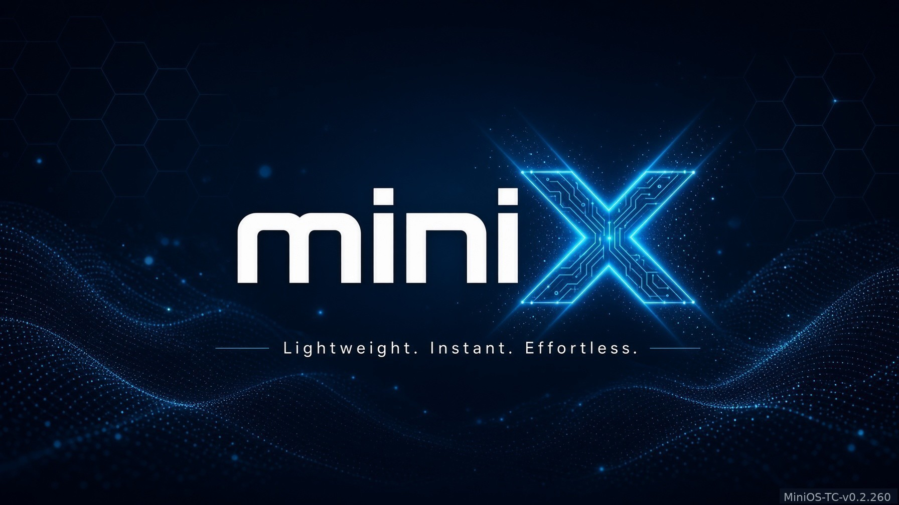

# MiniOS



This folder is the MiniOS package. Uploading this folder, or forking only this folder, is enough to write the USB stick and to change the project. The rest of a development tree is not required.

MiniOS is a live USB system for an old 32-bit PC. It starts from the stick and does not install onto the internal hard drive. The system it was built for is a Gateway MA3: one 32-bit core, about 441 MB of working memory, a 512 MB swap file, and no hardware video decoder. A change that needs a second core, 64-bit code, a hardware decoder, or a large copy in memory will not run on that machine.

The name TinyOS in older notes means Tiny Core Linux. MiniOS is not a fork of the Tiny Core GitHub group, and it is not Tianocore.

## The image in this folder

| Item | Value |
| --- | --- |
| File | `MiniOS-TC-v0.2.260-bar.img` |
| Size | 905969664 bytes (864 MiB) |
| SHA-256 | `C9237E3E63DAFBF83E152ECAE8807AD65B6075B5BB69E88B457B42F8F863875E` |
| MD5 | `FF61011583D0F0E0F6E1DC50EFCDFB0A` |
| Desktop caption | MiniOS-TC-v0.2.260 |
| Windows volume name | MINIOS-2260 |
| Base | Tiny Core Linux 16.2, 32-bit |
| Boot | Live USB only. Legacy / CSM. Not a 64-bit-only UEFI machine. |

The same hashes are in `SHA256SUMS.txt` and `VERSION.txt`.

On Windows PowerShell, from this folder:

```
Get-FileHash .\MiniOS-TC-v0.2.260-bar.img -Algorithm SHA256
```

The hash must match the table above.

## Write the stick

Use a USB stick of at least 1 GB. A 2 GB stick leaves a little room. Do not select the internal disk.

Rufus on Windows:

1. Download Rufus from https://rufus.ie and start it as administrator.
2. Insert the USB stick and select that stick.
3. Click SELECT and choose `MiniOS-TC-v0.2.260-bar.img`.
4. When Rufus asks how to write the image, choose **DD Image**. Do not choose ISO mode.
5. Click START and wait until Rufus says READY.
6. If Windows then asks to format the stick, click Cancel.

Do not format the stick after Rufus finishes. Do not delete the files Windows shows on the small visible part of the stick. The system partition starts at byte 1048576. Windows only shows the FAT boot area.

On Linux, find the stick with `lsblk` before and after you insert it. Use the disk name, for example `/dev/sdb`, not a partition such as `/dev/sdb1`.

```
sudo dd if=MiniOS-TC-v0.2.260-bar.img of=/dev/sdX bs=4M status=progress conv=fsync
```

## Boot

1. Leave the stick inserted and turn the PC on.
2. Open the boot menu (often F10, F12, or Esc) and choose the USB stick. If the PC is set to UEFI only, switch USB boot to Legacy / CSM.
3. The menu line **Start MiniOS** is already selected and starts after a few seconds. Press Enter to start it now.
4. The other line, **MiniOS command line only**, is for a desktop that does not start. The user name is `tc`. Press Enter at the password prompt.
5. The boot text says **Loading MiniOS**. The corner of the desktop reads **MiniOS-TC-v0.2.260**.

The first start of a new stick can sit on a blue screen after “Setting hostname to box.” If it is still there after a few minutes, power off and boot the same stick again.

## The desktop

A row of buttons runs along the bottom. The picture behind them is 1792 by 1008 and is painted with `feh --bg-scale`. The file is `source/wallpaper/mini-os-bg.jpg`.

| Button | What it does |
| --- | --- |
| YouTube | Searches YouTube and plays a result in the YouTube player. |
| TikTok | Searches TikTok and plays a result in the TikTok player. The seconds button stays at 30. |
| Streaming | Searches free radio and picture stations. Audio controls sit on the selected row. A picture station opens the Streaming player. |
| Nightly | Web browser. Pictures are on. JavaScript starts off. **Click here** on a heavy page turns JavaScript on until the next reboot. |
| Text Browser | One text-only browser window. |
| Media Player | Plays a local video or music file. |
| Games | A small menu. `1` is GTK Tetris, `2` is LBreakout2. The first use downloads about 2.6 MB. |
| AI | A chat window. It needs the network. |
| Document | AbiWord. It loads when the button is clicked. It is not loaded at boot. |
| Spreadsheet | Gnumeric. It loads when the button is clicked. It is not loaded at boot. |
| Wifi | Connects to a wireless network. The Gateway uses a Broadcom 4318 and the b43 driver. |
| Refresh RAM | Frees memory after a heavy program. |
| Exit | Leaves MiniOS. |

Document and Spreadsheet are also under Applications in the desktop menu. Open one of those programs at a time on the Gateway.

YouTube and TikTok do not share a player, a downloader, or temporary-file names. Closing Streaming does not stop a YouTube video. A live station does not get a time slider.

## What is in this folder

| Path | What it is |
| --- | --- |
| `MiniOS-TC-v0.2.260-bar.img` | The stick image. Flash this file. |
| `source/scripts/` | The MiniOS programs the bake copies onto the stick. Edit these. |
| `source/usb-binaries/` | The YouTube player, the YouTube mplayer wrapper, and the TikTok player bar that are on this image. Do not replace them. |
| `source/restore-106/` | Saved YouTube files from the v0.2.106 restore. The mplayer wrapper here matches the stick. The player-bar file here does not. |
| `source/fltube-src/` | Source of the YouTube search window. |
| `source/compile/` | Scripts that compile the 32-bit programs. |
| `source/tcz-office/` | AbiWord, Gnumeric, and the Tiny Core packages they need. Already inside the image. Kept so a later bake can put them back. |
| `source/icons/` | Pictures for the bottom bar, including Streaming, Document, and Spreadsheet. |
| `source/wallpaper/` | The 1792x1008 desktop picture taken from this image. |
| `source/browser-tweaks/` | Small Nightly memory notes. Not required to boot. |
| `bake/build-bake-ap01-v260.sh` | Record of the bake that made this image. Its paths point at the development machine. Do not run it from this folder. |
| `bake/build-next-image.sh` | Builds the next image from this folder. |
| `docs/WHAT-MINIOS-CHANGED.md` | What MiniOS added to Tiny Core 16.2. |
| `docs/FUNCTION-MAP.md` | How the programs call each other. Some call lists are older than this image. The file in `source/scripts/` wins. |
| `docs/FILES.md` | Points to this table. Run `git ls-files` for the full list. |
| `docs/RULES.md` | Rules for a change that still runs on the Gateway. |
| `out/` | Empty until a next bake. The new image is written here. |

`docs/WHAT-MINIOS-CHANGED.md` explains the Tiny Core changes. `docs/RULES.md` is the short list to read before an edit.

## Change the project and bake the next image

1. Edit the program you mean to change under `source/scripts/`. Leave the other program alone. YouTube names start with `minios-yt` or `minios-mp`. TikTok names start with `minios-tt`. Streaming names start with `minios-st` or `minios-streaming`.
2. Do not replace the three files in `source/usb-binaries/`.
3. Do not ship `source/scripts/minios-mplayer`. That wrapper is not the one on the stick. The stick wrapper is `source/usb-binaries/minios-mplayer`.
4. Do not compile `source/scripts/minios-player-bar` or `source/scripts/minios-tt-player-bar.cxx` and put the result on the stick.
5. On a machine with WSL, from this folder, run:

```
wsl -u root bash bake/build-next-image.sh
```

The script must be run as root. It reads `MiniOS-TC-v0.2.260-bar.img`, copies the programs in `source/scripts/` into a new image, and writes:

- `out/MiniOS-TC-v0.2.261-edit.img`
- `out/MiniOS-TC-v0.2.261-edit.img.copy`

The `.copy` file is the check that the write matched. After the script prints `BAKE_NEXT_OK` and `COPIES_MATCH`, the `.copy` file can be deleted. The script refuses to overwrite `MiniOS-TC-v0.2.260-bar.img`.

The next image caption is MiniOS-TC-v0.2.261. The volume name is MINIOS-2261. To use another number, edit the `VER`, `IMG_NAME`, and `CAPTION` lines at the top of `bake/build-next-image.sh`, the kernel line that changes `0.2.260` into the new number, and the volume text `MINIOS-2261`. The volume name is `MINIOS-` plus the minor number and the patch number, and it must be 11 characters or fewer. `0.2.261` becomes `MINIOS-2261`.

Several player files are locked to a checksum inside the bake script. If you change one of those files, the bake stops until the matching checksum in `bake/build-next-image.sh` is updated in the same edit. The locks exist so a dock change cannot quietly replace the YouTube or TikTok player. The dock script, the bar starter, the boot scripts, and the Streaming programs are the files a menu or Streaming change normally edits.

This PC has no desktop, so the package was not booted here. The Gateway has not been reported on v0.2.260 in the notes that came with the image.

## How the stick is built

Tiny Core’s own files and the MiniOS programs live in one image.

- Byte 1048576 is the start of the FAT partition.
- The FAT area holds the boot files and `cde/optional/*.tcz`. Those are Tiny Core extensions. AbiWord and Gnumeric are in that folder and are not loaded at boot.
- `boot/core.gz` is the root filesystem. MiniOS programs are installed under `/opt/minios/` inside it.
- The bottom bar program is Tiny Core `wbar`. The script that starts it on this image is `source/scripts/wbar-wait.sh`, installed as `/usr/local/bin/wbar.sh` inside `wbar.tcz`.
- The desktop file `/etc/skel/.xsession` comes from Tiny Core Xlibs. It starts `wbar.sh`, then runs each file in `/usr/local/etc/X.d`. One of those files runs `/opt/minios/swap-wbar.sh`, which is `source/scripts/minios-swap-wbar`.
- On this image `wbar.sh` builds the icon list and then draws the bar once. `swap-wbar.sh` writes the icons, including Streaming, and does not start the bar a second time.

A new image is made by copying this image and replacing files inside `core.gz` and `wbar.tcz`. It is not made by recompiling Tiny Core from the upstream ISO. The upstream 16.2 files are at http://tinycorelinux.net/16.x/x86/ . The kernel sources are under `release/src/` on that site. Tiny Core’s GitHub group, https://github.com/tinycorelinux , is a set of small repositories. It is not this system, and this project does not fork it.

## Git LFS

The image is stored with Git LFS (`*.img` is listed in `.gitattributes`). Install Git LFS before cloning or pushing, or the image downloads as a small pointer file. The other files are small enough for a normal commit. `source/tcz-office/` is about 55 MB spread across many files.

## Left out on purpose

- Older stick images. They are not needed to flash this one or to bake the next one.
- The experimental local language-model folder (`llamafile` and `model.gguf`). That test is not part of the image. It is too heavy for 441 MB.
- Session transcripts and the long history of earlier bakes.
- The old antiX tree that used to live at the repository root. It is not on the USB.
- The Tiny Core 16.2 ISO. This image already contains that system plus the MiniOS files.

## Licenses

Tiny Core Linux and the extensions in `source/tcz-office/` keep the licenses they shipped with. The MiniOS programs in `source/scripts/` and `source/fltube-src/` are the project files for this package. This folder does not add a new license on top of Tiny Core.
